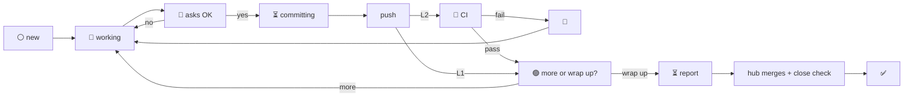
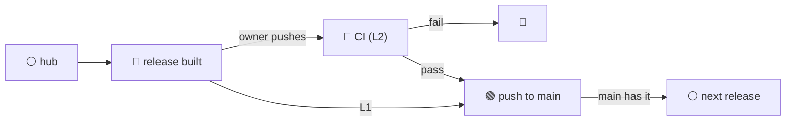

# chat-hub-core

A Claude Code plugin for running many Claude chats on one project, with
one **hub** chat in charge.

## Features

- **One hub, many chats.** You talk to the hub; it starts a chat per task
  (each on its own branch and worktree), briefs it, tracks it, and tells
  you when it can close.
- **Sidebar as status board.** Every title shows a code, a release and a
  status symbol, so you see who's waiting on you at a glance.
- **You stay in control.** Nothing is committed without your OK, which
  you give with one click in a menu, and every push to `main` is yours.
  Git hooks block rebases, commits on main or without your OK, and edits
  to another chat's folder.
- **Releases built in.** Finished work gathers on a `release` preview
  branch; a close check confirms each chat is committed, pushed, merged
  and (with CI) green.
- **No lock-in.** Works with any git host, CI or framework. Start with
  chats only; add branches and CI later.

## Levels

Pick one at setup; change it any time.

| Level | You get | Needs |
|---|---|---|
| **0** | Hub + one chat per task, coded titles, briefs, wrap-ups | nothing |
| **1** | + each chat on its own branch; releases gather finished branches | git |
| **2** | + `main` only gets releases that passed CI | a CI you can query |

More: [Levels in detail](#levels-in-detail).

## Status symbols

| | Meaning | Level |
|---|---|---|
| ⚪ | New: just started, nothing reported yet (also talk chats and the hub) | all |
| 🔨 | Under way, nothing waiting on you | all |
| 🙋 | Waiting on your OK | all |
| ❓ | Waiting on your answer | all |
| ⏳ | OK given, committing | all |
| 🚀 | Push in CI | 2 |
| 🟢 | Pushed (1) or CI passed (2): more, or wrap up? | 1+ |
| 🔴 | CI failed | 2 |
| ✅ | Ready to close | all |

The hub's own title uses ⚪ normally, and during a release 🙋 (built,
waiting on your push), 🚀 (release in CI), 🟢 (CI passed, push to main),
🔴 (CI failed), ❓ (question for you); ⚪ again once main has it.
Its title ends with the number of chats still open for that release, in
parentheses: `⚪  Hub · ʀ07 (6)`. Talk chats and ✅ chats don't count;
`(0)` means the release's work is all done. The hub updates it only
when it retitles a chat anyway (starting, retagging, ✅, closing) and
after a release.

## Flow



The hub during a release:



Who sets each one and when: [Title symbols](#title-symbols).

## Example sidebar

```
⚪  Hub · ʀ07 (6)
🙋  ʀ07 3F · (Fix menu spacing)
❓  ʀ07 A4 · (Add CSV export)
⏳  ʀ07 C2 · (Rename settings keys)
⚪  ʀ07 C3 · (Print view)
🚀  ʀ07 E5 · (Faster search)
🔴  ʀ07 F8 · (Login timeout)
🟢  ʀ07 A7 · (Dark mode toggle)
🔨  ʀ07 E2 · (Import from Excel)
✅  ʀ07 C9 · (Update dependencies)
🔨  ʀ08 E3 · Bulk rename
⚪  ᴢ A6 · Compare libraries
```

`3F`, `A4`… are chat codes (they also start commit messages), `ʀ07` is the
release the work ships in, names in parentheses are in the coming release
(`ʀ08` work isn't yet), and small-caps `ᴢ` marks a talk chat with no code to ship.

## Install

You need Claude Code (terminal or the desktop app's Code tab), git and Node.

1. Add this marketplace (once per computer), in a terminal:

   ```
   claude plugin marketplace add jamaldeemer/chat-hub-core
   ```

2. Turn the plugin on in your project:

   ```
   cd path/to/your-project
   claude plugin install chat-hub-core@chat-hub --scope project
   ```

   Starting from an empty folder? Run `git init` there first if you want
   level 1 or 2 (branches need git).

3. Open a new chat in the project (terminal or desktop app; trust the
   folder if asked) and type `/chat-hub-core:setup`. It asks a few
   questions, shows what it will write, and writes it when you say yes.
4. Setup ends by making a hub: by default the chat you ran it in. The hub
   records itself, so every other chat knows exactly which one it is, and
   adds the next release to its title (`⚪  Hub · ʀ2 (0)`). Then talk to it.
   To make a different chat the hub later, type
   `/chat-hub-core:hub replace` in it.

Setup writes only inside your project, and only after you say yes:

- `.claude/chat-hub.json`: the settings.
- `CLAUDE.md`: a short block between `<!-- chat-hub -->` markers.
- `.claude/settings.json`: only if you ask to pin a plugin version.
- Level 1+: `.githooks/pre-push`, the push guard. Each chat switches it on
  in its checkout if needed (`core.hooksPath`, which git doesn't commit).
- Level 2: one line in `.gitignore`.

Optional setting `startMode`: "ask" (default) has the hub ask you before
each chat whether it should **plan first** (look around, send a short
plan, wait for your go), **build it** (go straight to work, stop only
for the commit OK) or **just open** (start the dev server if
`devServer` is set, say it's ready, wait for your instructions);
"plan", "build" or "wait" skips the question.

Commit them and anyone who clones the project gets the same setup (they
only repeat steps 1–2). Run setup again to change level or other answers.

## Updating

**Which version am I on?** Type `/chat-hub-core:version` in any chat of
any project. It says which chat-hub-core version that project runs and
whether a newer one is out (the newest `v*` tag on GitHub, or the
marketplace copy when GitHub can't be reached), with the update command
below if it is.

When a new version is out, update every project that has the plugin at
once:

```
sh ~/.claude/plugins/marketplaces/chat-hub/scripts/update-all.sh
```

It updates the marketplace, then the plugin in each project, and prints
each project's old and new version (`--dry-run` shows the commands
without running them). To move just one project instead:

```
claude plugin marketplace update chat-hub
cd path/to/your-project
claude plugin update chat-hub-core@chat-hub
```

Open chats don't need a restart. Their hooks run through a small
launcher (`hooks/run.mjs`) that always runs the version the project has
installed now, and on its next prompt each chat is told to read its new
rules. It's told to restart only when the update changes which hooks run.
(Chats started on 0.3.20 or earlier don't have the launcher yet: restart
those once after moving to 0.3.21.) Run setup again if the CHANGELOG says
to. Projects you don't update stay on the version they have. Each chat's
stats line starts with the version its hooks are running; `claude plugin
list` shows each project's.

## Levels in detail

| Level | Adds | Needs |
|---|---|---|
| 0 | Hub + one chat per task, codes in titles (see [Titles](#titles)), briefs, wrap-ups | nothing |
| 1 | Each chat on its own branch; releases gather finished branches | git |
| 2 | `main` only gets releases that passed CI and whose fixes you've checked | CI you can ask "did commit X pass?" |

What happens to your code at each level:

```
LEVEL 0 · chats only (git optional)

  you <-> hub --brief--> 3F chat  --commits, with your OK--> your project


LEVEL 1 · + branches

  3F chat  --+   each on its own branch + worktree
  A7 chat  --+--push branch--> hub merges each finished branch into
  ...      --+                 `release` (a preview) and runs your
                               `checks` command (tests, build...)
                                          |
                     you say "release" and pick the branches
                                          v
                               `release` = main + those branches
                                          |  you push it to main
                                          v
                                        main --> every open chat merges main
                                                 (pushed with its next change)


LEVEL 2 · + CI and checks

  chat pushes its branch ----> CI runs     (its title shows the in-CI mark)
  you push `release` --------> CI runs on that exact commit
                                          |
                  CI passed, and you've tried every "Fixes #n" it ships
                                          v
                        you push that same commit to main

  The pre-push hook refuses main if CI hasn't passed on that commit,
  or a fix it ships is still listed in .claude/issues-to-check.md.
```

## Titles

Each work chat gets a two-character code (one of A C E F plus a digit
2–9, e.g. `3F`, `A7`), which also starts its commit messages (`3F: Fix the
menu`). Every title starts with its status symbol and two spaces. Setup
asks which title style the project wants:

| | Code first (default) | Release first |
|---|---|---|
| New, nothing reported yet | `⚪  3F · (Fix menu spacing) (ʀ7)` | `⚪  ʀ07 3F · (Fix menu spacing)` |
| Under way, nothing waiting on you | `🔨  3F · (Fix menu spacing) (ʀ7)` | `🔨  ʀ07 3F · (Fix menu spacing)` |
| Tick-tock releases | `🔨  3F · (Fix menu spacing) (ʀ16~)` | `🔨  ʀ16~ 3F · (Fix menu spacing)` |
| Waiting on your OK | `🙋  3F · (Fix menu spacing) (ʀ7)` | `🙋  ʀ07 3F · (Fix menu spacing)` |
| Waiting on your answer | `❓  3F · (Fix menu spacing) (ʀ7)` | `❓  ʀ07 3F · (Fix menu spacing)` |
| OK given, committing | `⏳  3F · (Fix menu spacing) (ʀ7)` | `⏳  ʀ07 3F · (Fix menu spacing)` |
| Push in CI (level 2) | `🚀  3F · (Fix menu spacing) (ʀ7)` | `🚀  ʀ07 3F · (Fix menu spacing)` |
| Pushed / CI passed: more or wrap up? | `🟢  3F · (Fix menu spacing) (ʀ7)` | `🟢  ʀ07 3F · (Fix menu spacing)` |
| CI failed (level 2) | `🔴  3F · (Fix menu spacing) (ʀ7)` | `🔴  ʀ07 3F · (Fix menu spacing)` |
| Ready to close | `✅  3F · (Fix menu spacing) (ʀ7)` | `✅  ʀ07 3F · (Fix menu spacing)` |
| Later release (not the next one) | `🔨  3F · Fix menu spacing (ʀ8)` | `🔨  ʀ08 3F · Fix menu spacing` |
| Talk chat (no release) | `⚪  A4 · Compare libraries` | `⚪  ᴢ A4 · Compare libraries` |
| The hub | `⚪  Hub · ʀ7 (6)` | `⚪  Hub · ʀ07 (6)` |

Talk chats and the hub keep ⚪ (talk chats show ❓ while waiting on your
answer): they never push. A work chat leaves ⚪ for good once it
reports anything: after that it shows 🔨 whenever nothing waits on you.

### Title symbols

Each chat sets its own symbol the moment its status changes, so the
sidebar is never behind and the hub isn't woken for it; the hub sets
only ⚪ (starting a chat), ✅ (closing it) and the rest of every title.
(If a chat's rename ever fails, it tells the hub, which sets it.)

| Symbol | Meaning | Set when | Level |
|---|---|---|---|
| ⚪ | New: the chat hasn't set anything yet (also talk chats, the hub) | the hub starts the chat | all |
| 🔨 | Under way, nothing waiting on you | the chat starts work, you answer "More changes", decline an OK, or answer its question | all |
| 🙋 | Waiting on your OK to commit, merge or push | the chat asks you for an OK | all |
| ❓ | Waiting on your answer to a question (not an OK) | the chat ends a turn on a question to you (not a closing "anything else?"), a plan to approve, or "waiting for instructions" | all |
| ⏳ | OK given, committing and pushing; or wrapping up (report in, being closed) | you say yes to an OK, or the chat sends its wrap-up report | all |
| 🚀 | Push in CI | the chat pushes | 2 |
| 🟢 | Pushed (level 1) or CI passed (level 2); the chat is asking "Anything more, or should I wrap up?" in a menu ("Wrap up" / "More changes"); it changes as soon as you answer, so 🟢 always means the question is open | the chat pushes / its CI run passes | 1+ |
| 🔴 | CI failed | its CI run fails | 2 |
| ✅ | Ready to close | the hub: the chat's wrap-up passes the close check | all |

The release tag's letter is small-caps `ʀ` (`ʀ07`, `(ʀ7)`), so it
stands apart from the code; the digits, `~` and `+` stay plain. Older
titles with a plain `R` still count as the same release, and the hub
writes `ʀ` the next time it sets them.

Chats in the coming release (the one in the hub's title) have their name,
the part after the code, in parentheses, so that release's work stands
out: `🔨  ʀ24~ 9A · (Colour palette review)` next to
`🙋  ʀ25+ F2 · Staging download buttons`. Talk chats and the hub's own
title don't get them. After a release the hub adds them to the chats
now in the new coming release, in the same batch as the retag; a chat
retagged to a later release loses them.

A title is about 40 characters at most, everything included (symbol,
tag, code, name, parentheses), so the sidebar doesn't cut it off; the
hub shortens the name to fit when it starts or retitles a chat.

Release first pads the number to two digits, so an alphabetical sort
groups chats by release, and talk chats (`ᴢ `) sort last. With tick-tock,
`~` releases are fixes and `+` releases features; the hub's title shows
the soonest next release (`⚪  Hub · ʀ15+ (2)`). The hub also keeps notes in
git's own folder (`.git/chat-hub/hub-notes.md`), so a restart or a clear
loses nothing. In the desktop app the start hook knows the hub by its app
address, which a clear doesn't change, so a cleared hub is told it's the
hub outright (and its new session ID recorded) instead of having to work
it out.

## How it works

The rules are three skills: `setup`, `hub`, `work-chat`. A start-of-chat
hook tells each chat which to load, and which chat is the hub: the hub
records itself in git's own folder (never committed) by two IDs, Claude's
session ID and the desktop app's address, so every chat and worktree sees
it at once, can message it, and it stays the hub after a restart. Your
project gets a settings file,
`.claude/chat-hub.json` (level, release style, what "done" means, the
command that runs your checks, the CI command), and a three-line note in CLAUDE.md. At level 1+, a guard hook
refuses a few things outright instead of trusting chats to remember:
committing on main, rebasing, editing another chat's folder, and (any
level) commit messages without a code or without your OK: a work chat
must ask with a menu (AskUserQuestion, "Yes, commit" / "Not yet"), and
the hook checks the chat's transcript for a yes since its last commit
(`"okMenu": false` turns this off where there's no menu tool). When
something is wrong (a broken settings file, no hub, a hub it can't
reach), chats stop and tell you rather than guess.

**Token use.** After every turn you see one line, e.g. `Context 182k ·
312 turns · this chat ≈ 41M token-reads` (Claude doesn't see it; set
`"stats": false` to hide it). Every turn re-reads the whole context, so
long chats, the hub above all, cost the most. When the hub passes
`trimAt` (default 135k tokens) it wraps up: it takes on no new work
(anything new you or a chat ask for goes in its notes as an
"After clear:" line, which the start note quotes back to it after the
clear), finishes what it already has in flight (a merge or release it
started, closing every chat whose wrap-up report is in, titles it owes,
replies to chats, messages it promised), brings
its notes up to date, and only then asks you to clear it, so a clear
never lands in the middle of a step. Until then each reply starts
"⚠️ Hub at …: wrapping up", then "⚠️ Wrapped up, notes saved. Type
/clear in this chat to clear it." The hub never asks you about clearing
(no question or buttons: a button can't clear a chat); you just type
`/clear` in the hub chat. Work chats get a similar reminder past `trimAtWork`,
if set: stop at a natural point, note where they are, ask to be cleared.

**Changing the limits as you go.** Type `/chat-hub-core:limit 200k` in any
chat to move the hub's limit, `/chat-hub-core:limit work 100k` (or
`work off`) for work chats, `/chat-hub-core:limit` to see both and where
they come from, `/chat-hub-core:limit default` to go back to the settings.
Every chat uses the new limit from its next prompt, no restart. It's kept
in git's own folder (`.git/chat-hub/limits.json`, next to the hub record),
so every worktree sees it and it's never committed; it wins over `trimAt`
and `trimAtWork` in `.claude/chat-hub.json`. Raise the hub's limit while
it's wrapping up and it carries on as normal.

**Set the limit well above the hub's base.** A fresh hub already holds
its tools, skills list, CLAUDE.md and its own rules before you say
anything: about 88k tokens on one large project. Measure yours (the stats
line after the hub's first turn) and keep `trimAt` comfortably above it,
or the hub wraps up almost as soon as it starts.

**Turning off tools a project doesn't use.** Every tool a chat has costs
context on every turn, the hub's most of all, and most chats never touch
the Browser pane, the iOS simulator or Artifacts (about 12k tokens on its
own). The iOS simulator, Artifacts and the rarely used extras (groups 2,
4 and 13–27, about 15k tokens a chat) are **off by default**: the first
chat after setup or an update turns them off once and says so (new chats
start without them). Turn one back on with `/chat-hub-core:tools on ios`
and it stays on. Setup shows the numbered list and asks about the rest;
change it any time with `/chat-hub-core:tools`:

| Command | Does |
|---|---|
| `/chat-hub-core:tools` | lists every tool group, numbered, on or off |
| `/chat-hub-core:tools off 4 13-27` | turns groups off by number, name (`off artifacts ios`) or single tool (`off SendUserFile`); `off unused`: the rarely used extras |
| `/chat-hub-core:tools on browser` | turns them back on (`on all`: every group) |

The groups cover every tool a desktop-app chat gets (Browser pane, iOS
simulator, charts, Artifacts, helper agents, web search, Workflows,
scheduling, layout, plan mode and so on); the tools chat-hub-core itself
needs (Bash, Read, Edit, Write, Skill, messaging and the app's session
tools) always stay on. It writes deny rules into the project's
`.claude/settings.local.json` (just you, never committed): a denied tool
is removed from the chat entirely, not just blocked. In the desktop app,
worktree chats read the main checkout's settings, so the hub and work
chats always get the same set. New chats load it; restart an open chat
to drop or get them. Which default groups were already turned off is
kept in `.git/chat-hub/tools.json`, so each is turned off only once. Since an off tool is invisible, every chat's start
note names what's off in one line, so a chat that needs one asks you to
type `/chat-hub-core:tools on <name>`. Tools you never use anywhere can go in your own
`~/.claude/settings.json` the same way (`"permissions": {"deny":
["mcp__visualize"]}`), and plugins you don't use in a project can be
turned off there with `"enabledPlugins": {"<plugin>": false}`, which also
shortens the skills list every chat carries.

**Hub notes.** The hub keeps one current snapshot of its notes under fixed
headings, edited in place. If they gain other `## ` headings (dated or
"checkpoint" blocks) or pass `notesMaxBytes` (default 6000; 0 = off), a
hook tells the hub to rewrite them before anything else. A closed (✅)
chat is dropped from the notes as soon as the hub tells you about it, so
the hub never reminds you of chats you've already deleted; the same hook
flags any ✅ line left in the notes.

A chat is marked ✅ (ready to close) only after it sends
a fixed wrap-up report and the hub's `close-check` confirms its folder is
committed, pushed, merged into the release preview and (level 2) green;
you archive it. At level 1+ the hub does all of that with one command,
`hooks/close-chat.mjs <branch>`: it merges the branch into the preview,
runs your `checks` command on the merge (skipped when the merge adds
nothing to the branch, since the chat already ran them), runs the close
check, and prints READY or FAIL, so ✅ comes in the same turn. Nothing in the plugin names a git host, CI service or
framework.

## Working on the plugin

- Try unreleased changes: `claude --plugin-dir path/to/chat-hub-core`
- Checks: `sh tests/run.sh` and `claude plugin validate .`
- After changing a prompt: `sh scripts/all-prompts.sh` rebuilds
  `docs/all-prompts.md`.
- Release: bump `version` in `.claude-plugin/plugin.json`, add a
  `CHANGELOG.md` section, commit on `release`, `git tag vX.Y.Z release`,
  then one push: `git push origin release:main vX.Y.Z`.
  Projects move to it when their owner runs the Updating steps.

## License

MIT
