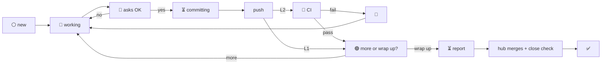
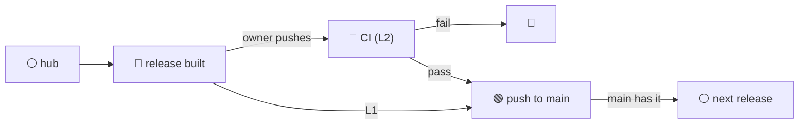

# chat-hub-core

A Claude Code plugin for running many Claude chats on one project, with
one **hub** chat in charge.

## Features

- **One hub, many chats.** You talk to the hub; it starts a chat per task
  (each on its own branch and worktree), briefs it, tracks it, and tells
  you when it can close.
- **Sidebar as status board.** Every title shows a code, a release and a
  status symbol, so you see who's waiting on you at a glance.
- **You stay in control.** Nothing is committed without your OK, which
  you give with one click in a menu, and every push to `main` is yours.
  Git hooks block rebases, commits on main or without your OK, and edits
  to another chat's folder.
- **Releases built in.** Finished work gathers on a `release` preview
  branch; one command merges, tests and checks each chat before it closes.
- **Light on context.** A usage line after every turn, a hub that wraps
  itself up at a limit you set, and unused tools off by default.
- **No lock-in.** Works with any git host, CI or framework. Start with
  chats only; add branches and CI later.

## Levels

Pick one at setup; change it any time.

| Level | You get | Needs |
|---|---|---|
| **0** | Hub + one chat per task, coded titles, briefs, wrap-ups | nothing |
| **1** | + each chat on its own branch; releases gather finished branches | git |
| **2** | + `main` only gets releases that passed CI | a CI you can query |

More: [Levels in detail](#levels-in-detail).

## Status symbols

| | Meaning | Level |
|---|---|---|
| ⚪ | New: just started, nothing reported yet (also talk chats and the hub) | all |
| 🔨 | Under way, nothing waiting on you | all |
| 🙋 | Waiting on your OK | all |
| ❓ | Waiting on your answer | all |
| ⏳ | OK given, committing | all |
| 🚀 | Push in CI | 2 |
| 🟢 | Pushed (1) or CI passed (2): more, or wrap up? | 1+ |
| 🔴 | CI failed | 2 |
| ✅ | Ready to close | all |

The hub's own title uses ⚪ normally, and during a release 🙋 (built,
waiting on your push), 🚀 (release in CI), 🟢 (CI passed, push to main),
🔴 (CI failed), ❓ (question for you); ⚪ again once main has it.

## Flow



The same flow, as one chat's title in the sidebar (level 1):

```
⚪  ʀ12 E4 · (Add CSV export)   the hub starts it
🔨  ʀ12 E4 · (Add CSV export)   it starts work
❓  ʀ12 E4 · (Add CSV export)   "Comma or semicolon?"
🔨  ʀ12 E4 · (Add CSV export)   you answer
🙋  ʀ12 E4 · (Add CSV export)   OK to commit? (a menu)
⏳  ʀ12 E4 · (Add CSV export)   you click "Yes, commit"
🟢  ʀ12 E4 · (Add CSV export)   pushed: anything more, or wrap up?
⏳  ʀ12 E4 · (Add CSV export)   you click "Wrap up"
✅  ʀ12 E4 · (Add CSV export)   merged, tested, ready to close
```

The chat sets every symbol itself the moment it changes; the hub sets
only ⚪ and ✅.

The hub during a release:



Who sets each one and when: [Title symbols](#title-symbols).

## Example sidebar

```
⚪  Hub · ʀ07 (8)
🙋  ʀ07 3F · (Fix menu spacing)
❓  ʀ07 A4 · (Add CSV export)
⏳  ʀ07 C2 · (Rename settings keys)
⚪  ʀ07 C3 · (Print view)
🚀  ʀ07 E5 · (Faster search)
🔴  ʀ07 F8 · (Login timeout)
🟢  ʀ07 A7 · (Dark mode toggle)
🔨  ʀ07 E2 · (Import from Excel)
✅  ʀ07 C9 · (Update dependencies)
🔨  ʀ08 E3 · Bulk rename
⚪  ᴢ A6 · Compare libraries
```

How to read it:

- `3F`, `A4`… are **chat codes**; they also start commit messages
  (`3F: Fix the menu`).
- `ʀ07` is the **release** the work ships in. The small-caps `ʀ` keeps it
  apart from the code.
- **Names in parentheses** are in the coming release; `ʀ08` work isn't
  yet, so `Bulk rename` has none.
- `ᴢ` marks a **talk chat**: a chat for questions or research, with no
  code to ship. Talk chats sort last.
- `(8)` on the hub is **how many chats are left** for its release: the
  nine `ʀ07` chats minus ✅ C9. Talk chats, later releases and ✅ chats
  don't count; `(0)` means the release's work is all done.

### The hub's count as a release goes by

```
⚪  Hub · ʀ12 (3)   three chats left for ʀ12
⚪  Hub · ʀ12 (2)   E4 got ✅
⚪  Hub · ʀ12 (1)   you deleted A5 yourself
🙋  Hub · ʀ12 (0)   all done; release built, waiting on your push
⚪  Hub · ʀ13 (2)   main has it; on to the next release
```

You don't tell the hub when you close or delete a chat yourself: it
recounts every time it wakes and fixes its title only if the count is
wrong.

After a release, chats for the new coming release get their names in
parentheses, in the same batch as the retag:

```
🔨  ʀ13 F2 · Bulk rename      while ʀ12 is the coming release
🔨  ʀ13 F2 · (Bulk rename)    once ʀ12 has shipped
```

## Commands

Type these in any chat of the project. Each answers in one short reply.

| Command | Does |
|---|---|
| `/chat-hub-core:setup` | sets the project up, or changes its level or answers |
| `/chat-hub-core:hub replace` | makes this chat the hub |
| `/chat-hub-core:limit` | shows or changes when the hub (and work chats) wrap up |
| `/chat-hub-core:tools` | shows or changes which tools every chat loads |
| `/chat-hub-core:version` | shows this project's version and whether a newer one is out |

What they look like:

```
> /chat-hub-core:limit
Context limits: hub wraps up at 135k (default); work chats have no limit
(default). At its limit the hub can't start chats or releases; at 155k (20k
more, hardStopAfter) it can only write its notes until cleared.

> /chat-hub-core:limit 200k
Saved; every chat uses it from its next prompt. Context limits: hub wraps up
at 200k (set with /chat-hub-core:limit); work chats have no limit (default). …

> /chat-hub-core:version
This project runs chat-hub-core 0.3.40. Newer: 0.3.41 is out (newest tag on
GitHub). To update every project, run: sh ~/.claude/plugins/marketplaces/chat-hub/scripts/update-all.sh

> /chat-hub-core:tools
Tools for every chat in this project:
 1. on   browser: Browser pane (keep for a web UI) (mcp__Claude_Browser)
 2. off  ios: iOS simulator (keep for an iOS app) (mcp__Claude_Code_iOS_Simulator)
 3. on   charts: inline charts and diagrams (mcp__visualize, …)
 4. off  artifacts: Artifacts (published pages) (Artifact, ArtifactComments, ArtifactData)
 …
27. off  worktrees: switching worktrees (EnterWorktree, ExitWorktree)
```

More on each: [limits](#context-and-limits), [tools](#turning-off-tools).

## Starting a chat

When you ask the hub for something, it asks how the chat should start:

- **Plan first:** the chat looks around, sends you a short plan, sets ❓
  and waits for your go.
- **Build it:** straight to work (🔨); it stops only for the commit OK.
- **Just open:** it starts the dev server if `devServer` is set, says
  it's ready, and waits for your instructions.

Set `startMode` in `.claude/chat-hub.json` to `"plan"`, `"build"` or
`"wait"` to skip the question (`"ask"` is the default).

## Install

You need Claude Code (terminal or the desktop app's Code tab), git and Node.

1. Add this marketplace (once per computer), in a terminal:

   ```
   claude plugin marketplace add jamaldeemer/chat-hub-core
   ```

2. Turn the plugin on in your project:

   ```
   cd path/to/your-project
   claude plugin install chat-hub-core@chat-hub --scope project
   ```

   Starting from an empty folder? Run `git init` there first if you want
   level 1 or 2 (branches need git).

3. Open a new chat in the project (terminal or desktop app; trust the
   folder if asked) and type `/chat-hub-core:setup`. It asks a few
   questions, shows what it will write, and writes it when you say yes.
4. Setup ends by making a hub: by default the chat you ran it in. The hub
   records itself, so every other chat knows exactly which one it is, and
   adds the next release to its title (`⚪  Hub · ʀ2 (0)`). Then talk to it.
   To make a different chat the hub later, type
   `/chat-hub-core:hub replace` in it.

Setup writes only inside your project, and only after you say yes:

- `.claude/chat-hub.json`: the settings.
- `CLAUDE.md`: a short block between `<!-- chat-hub -->` markers.
- `.claude/settings.json`: only if you ask to pin a plugin version.
- Level 1+: `.githooks/pre-push`, the push guard. Each chat switches it on
  in its checkout if needed (`core.hooksPath`, which git doesn't commit).
- Level 2: one line in `.gitignore`.

Commit them and anyone who clones the project gets the same setup (they
only repeat steps 1–2). Run setup again to change level or other answers.

## Updating

**Which version am I on?** Type `/chat-hub-core:version` in any chat of
any project (example under [Commands](#commands)).

When a new version is out, update every project that has the plugin at
once:

```
sh ~/.claude/plugins/marketplaces/chat-hub/scripts/update-all.sh
```

It updates the marketplace, then the plugin in each project, and prints
each project's old and new version (`--dry-run` shows the commands
without running them). To move just one project instead:

```
claude plugin marketplace update chat-hub
cd path/to/your-project
claude plugin update chat-hub-core@chat-hub
```

Open chats don't need a restart. All you see is one line from the app,
"Updated" ("Updated: restart this chat" when the update changes which
hooks run); the chat reads its new rules quietly. Run setup again if the
CHANGELOG says to. Projects you don't update stay on the version they
have.

## Levels in detail

| Level | Adds | Needs |
|---|---|---|
| 0 | Hub + one chat per task, codes in titles (see [Titles](#titles)), briefs, wrap-ups | nothing |
| 1 | Each chat on its own branch; releases gather finished branches | git |
| 2 | `main` only gets releases that passed CI and whose fixes you've checked | CI you can ask "did commit X pass?" |

What happens to your code at each level:

```
LEVEL 0 · chats only (git optional)

  you <-> hub --brief--> 3F chat  --commits, with your OK--> your project


LEVEL 1 · + branches

  3F chat  --+   each on its own branch + worktree
  A7 chat  --+--push branch--> hub merges each finished branch into
  ...      --+                 `release` (a preview) and runs your
                               `checks` command (tests, build...)
                                          |
                     you say "release" and pick the branches
                                          v
                               `release` = main + those branches
                                          |  you push it to main
                                          v
                                        main --> every open chat merges main
                                                 (pushed with its next change)


LEVEL 2 · + CI and checks

  chat pushes its branch ----> CI runs     (its title shows the in-CI mark)
  you push `release` --------> CI runs on that exact commit
                                          |
                  CI passed, and you've tried every "Fixes #n" it ships
                                          v
                        you push that same commit to main

  The pre-push hook refuses main if CI hasn't passed on that commit,
  or a fix it ships is still listed in .claude/issues-to-check.md.
```

## Titles

Each work chat gets a two-character code (one of A C E F plus a digit
2–9, e.g. `3F`, `A7`), which also starts its commit messages (`3F: Fix the
menu`). Every title starts with its status symbol and two spaces. Setup
asks which title style the project wants:

| | Code first (default) | Release first |
|---|---|---|
| New, nothing reported yet | `⚪  3F · (Fix menu spacing) (ʀ7)` | `⚪  ʀ07 3F · (Fix menu spacing)` |
| Under way, nothing waiting on you | `🔨  3F · (Fix menu spacing) (ʀ7)` | `🔨  ʀ07 3F · (Fix menu spacing)` |
| Tick-tock releases | `🔨  3F · (Fix menu spacing) (ʀ16~)` | `🔨  ʀ16~ 3F · (Fix menu spacing)` |
| Waiting on your OK | `🙋  3F · (Fix menu spacing) (ʀ7)` | `🙋  ʀ07 3F · (Fix menu spacing)` |
| Waiting on your answer | `❓  3F · (Fix menu spacing) (ʀ7)` | `❓  ʀ07 3F · (Fix menu spacing)` |
| OK given, committing | `⏳  3F · (Fix menu spacing) (ʀ7)` | `⏳  ʀ07 3F · (Fix menu spacing)` |
| Push in CI (level 2) | `🚀  3F · (Fix menu spacing) (ʀ7)` | `🚀  ʀ07 3F · (Fix menu spacing)` |
| Pushed / CI passed: more or wrap up? | `🟢  3F · (Fix menu spacing) (ʀ7)` | `🟢  ʀ07 3F · (Fix menu spacing)` |
| CI failed (level 2) | `🔴  3F · (Fix menu spacing) (ʀ7)` | `🔴  ʀ07 3F · (Fix menu spacing)` |
| Ready to close | `✅  3F · (Fix menu spacing) (ʀ7)` | `✅  ʀ07 3F · (Fix menu spacing)` |
| Later release (not the next one) | `🔨  3F · Fix menu spacing (ʀ8)` | `🔨  ʀ08 3F · Fix menu spacing` |
| Talk chat (no release) | `⚪  A4 · Compare libraries` | `⚪  ᴢ A4 · Compare libraries` |
| The hub | `⚪  Hub · ʀ7 (6)` | `⚪  Hub · ʀ07 (6)` |

Talk chats and the hub keep ⚪ (talk chats show ❓ while waiting on your
answer): they never push. A work chat leaves ⚪ for good once it
reports anything: after that it shows 🔨 whenever nothing waits on you.

### Title symbols

Each chat sets its own symbol the moment its status changes, so the
sidebar is never behind and the hub isn't woken for it; the hub sets
only ⚪ (starting a chat), ✅ (closing it) and the rest of every title.
(If a chat's rename ever fails, it tells the hub, which sets it.)

| Symbol | Meaning | Set when | Level |
|---|---|---|---|
| ⚪ | New: the chat hasn't set anything yet (also talk chats, the hub) | the hub starts the chat | all |
| 🔨 | Under way, nothing waiting on you | the chat starts work, you answer "More changes", decline an OK, or answer its question | all |
| 🙋 | Waiting on your OK to commit, merge or push | the chat asks you for an OK | all |
| ❓ | Waiting on your answer to a question (not an OK) | the chat ends a turn on a question to you (not a closing "anything else?"), a plan to approve, or "waiting for instructions" | all |
| ⏳ | OK given, committing and pushing; or wrapping up (report in, being closed) | you say yes to an OK, or the chat sends its wrap-up report | all |
| 🚀 | Push in CI | the chat pushes | 2 |
| 🟢 | Pushed (level 1) or CI passed (level 2); the chat is asking "Anything more, or should I wrap up?" in a menu ("Wrap up" / "More changes"); it changes as soon as you answer, so 🟢 always means the question is open | the chat pushes / its CI run passes | 1+ |
| 🔴 | CI failed | its CI run fails | 2 |
| ✅ | Ready to close | the hub: the chat's wrap-up passes the close check | all |

A hook checks each chat's title after every turn and sends it back once
to fix a missing symbol, one space instead of two, a plain `R` tag or ⚪
on a work chat that has started ([details](docs/how-it-works.md#the-title-check)).

### Release tags and names

The release tag's letter is small-caps `ʀ` (`ʀ07`, `(ʀ7)`), so it
stands apart from the code; the digits, `~` and `+` stay plain. Older
titles with a plain `R` still count as the same release, and the hub
writes `ʀ` the next time it sets them.

Chats in the coming release (the one in the hub's title) have their name,
the part after the code, in parentheses, so that release's work stands
out: `🔨  ʀ24~ 9A · (Colour palette review)` next to
`🙋  ʀ25+ F2 · Staging download buttons`. Talk chats and the hub's own
title don't get them. A chat retagged to a later release loses them.

A title is about 40 characters at most, everything included (symbol,
tag, code, name, parentheses), so the sidebar doesn't cut it off; the
hub shortens the name to fit when it starts or retitles a chat.

Release first pads the number to two digits, so an alphabetical sort
groups chats by release, and talk chats (`ᴢ `) sort last. With tick-tock,
`~` releases are fixes and `+` releases features; the hub's title shows
the soonest next release (`⚪  Hub · ʀ15+ (2)`).

## Context and limits

Every turn re-reads the chat's whole context, so long chats, the hub above
all, cost the most. After every turn (and when a chat opens) you see one
line the chat itself never sees:

```
chat-hub-core 0.3.41 · Context 182k · 312 turns · this chat ≈ 41M token-reads
chat-hub-core 0.3.41 · new chat
```

Set `"stats": false` in `.claude/chat-hub.json` to hide it.

**The hub wraps up at its limit** (`trimAt`, default 135k tokens). It
takes on nothing new (it notes new requests for after the clear),
finishes what's in flight, saves its notes, and only then asks you to
clear it. Each reply starts with:

```
⚠️ Hub at 141k tokens: wrapping up.
```

and once it's done:

```
╔════════════════════════════════════╗
║   ✅  SAFE TO CLEAR: type /clear   ║
╚════════════════════════════════════╝
```

There's no button for it (a button can't clear a chat): you type `/clear`
in the hub chat, and the hub picks up from its notes. Work chats get the
same lines past `trimAtWork`, if set.

**It's a hard stop, in two stages,** so the hub can't drift on for "just
one more thing":

| Context | The hub can't |
|---|---|
| past `trimAt` (135k) | start chats or build a release; finishing work (closing chats, merges, titles, messages, notes) still runs |
| `hardStopAfter` more (155k) | do anything but read and write its notes |

Only you can lift it, with `/chat-hub-core:limit <higher>` or
`/chat-hub-core:limit off`; a clear lifts it too. Work chats are never
stopped.

**Change the limits as you go** with `/chat-hub-core:limit`, no restart:

| Command | Does |
|---|---|
| `/chat-hub-core:limit` | shows both limits and where they come from |
| `/chat-hub-core:limit 200k` | moves the hub's limit |
| `/chat-hub-core:limit work 100k` | sets work chats' limit (`work off` turns it off) |
| `/chat-hub-core:limit default` | goes back to the settings |

Every chat uses the new limit from its next prompt, and it wins over
`trimAt` and `trimAtWork`. Raise the hub's limit while it's wrapping up
and it carries on as normal. Set `hardStopAfter` in
`.claude/chat-hub.json` to move the second stage (default 20k).

**Set the limit well above the hub's base.** A fresh hub already holds
its tools, skills list, CLAUDE.md and its own rules before you say
anything: about 88k tokens on one large project. Check the stats line
after the hub's first turn and keep `trimAt` comfortably above it, or the
hub wraps up almost as soon as it starts.

## Turning off tools

Every tool a chat has costs context on every turn, and most chats never
touch the Browser pane, the iOS simulator or Artifacts (about 12k tokens
on its own). The iOS simulator, Artifacts and the rarely used extras
(groups 2, 4 and 13–27, about 15k tokens a chat) are **off by default**:
the first chat after setup or an update turns them off once and says so.
Setup asks about the rest.

| Command | Does |
|---|---|
| `/chat-hub-core:tools` | lists every tool group, numbered, on or off |
| `/chat-hub-core:tools off 4 13-27` | turns groups off by number, name (`off artifacts ios`) or single tool (`off SendUserFile`); `off unused`: the rarely used extras |
| `/chat-hub-core:tools on browser` | turns them back on (`on all`: every group); it stays on |

The tools chat-hub-core itself needs (Bash, Read, Edit, Write, Skill,
messaging and the app's session tools) always stay on. New chats load the
change; restart an open chat to drop or get them. An off tool is
invisible, so every chat's start note names what's off:

```
Tools turned off in this project: ios, artifacts, chrome, workflows, …
If you need one, ask the owner to type `/chat-hub-core:tools on <name>`
(then restart this chat).
```

Where the rules are kept, and turning tools off for all your projects:
[details](docs/how-it-works.md#limits-and-tools-where-theyre-kept).

## Closing a chat

A finished chat closes at once: as soon as its wrap-up report is in, even
if its work ships in a later release (the branch waits in the `release`
preview, not in an open chat at ⏳). The hub closes it with one command
(level 1+), `hooks/close-chat.mjs <branch>`: it merges the branch into
the `release` preview, runs your checks on the merge, and checks the chat
is committed, pushed, merged and (level 2) green. ✅ comes in the same
turn:

```
PASS folder: …/worktrees/add-csv
PASS uncommitted: nothing
PASS branch: claude/add-csv
PASS pushed: all of it, to origin/claude/add-csv
PASS checks: `sh tests/run.sh` passed on the merge
PASS merge: claude/add-csv merged into release (4f2a9c1)
PASS merged: in the release preview (release)
READY to close claude/add-csv (if the report is complete and nothing waits on the owner).
```

If anything fails it says what, and leaves the preview as it was:

```
FAIL merge: clashes with release in src/export.ts; the chat merges release and resolves it
FAIL: claude/add-csv can't close yet (…).
```

The checks are your `checks` setting; without one, the commands in
backticks in `done`, else a default it finds (package.json scripts,
`tests/run.sh` or `make test`), and it says which it ran. You archive the
chat once it's ✅. If the hub ever leaves a reported chat at ⏳, a hook
reminds it on its next wake, also after a clear.

**CI after a clear (level 2).** A chat at 🚀 that gets cleared or
restarted loses the watcher it had on CI, so its start note says what CI
says about its pushed head:

```
CI passed on your pushed branch head 4f2a9c1. If your title still shows 🚀,
set 🟢 now and ask the owner "Anything more, or should I wrap up?" (menu).
```

The hub also checks every 🚀 chat when it wakes, as a backstop.

## How it works

The rules are three skills (`setup`, `hub`, `work-chat`), and hooks make
sure the important ones hold: no commit without your OK (a menu yes,
checked in the chat's transcript), no commits on main, no rebases, no
edits in another chat's folder, titles in the right shape. The hub keeps
its notes in git's own folder, so a restart or a clear loses nothing.
When something is wrong (a broken settings file, no hub, a hub it can't
reach), chats stop and tell you rather than guess.

Nothing in the plugin names a git host, CI service or framework.

All the details: [docs/how-it-works.md](docs/how-it-works.md).

## Working on the plugin

- Try unreleased changes: `claude --plugin-dir path/to/chat-hub-core`
- Checks: `sh tests/run.sh` and `claude plugin validate .`
- After changing a prompt: `sh scripts/all-prompts.sh` rebuilds
  `docs/all-prompts.md`.
- Release: bump `version` in `.claude-plugin/plugin.json`, add a
  `CHANGELOG.md` section, commit on `release`, `git tag vX.Y.Z release`,
  then one push: `git push origin release:main vX.Y.Z`.
  Projects move to it when their owner runs the Updating steps.

## License

MIT
