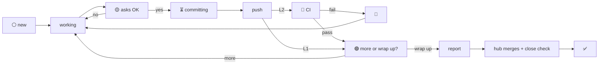
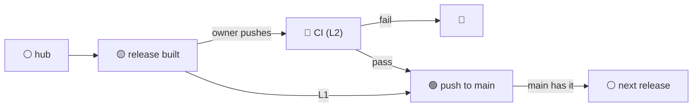

# chat-hub-core

A Claude Code plugin for running many Claude chats on one project, with
one **hub** chat in charge.

## Features

- **One hub, many chats.** You talk to the hub; it starts a chat per task
  (each on its own branch and worktree), briefs it, tracks it, and tells
  you when it can close.
- **Sidebar as status board.** Every title shows a code, a release and a
  status symbol, so you see who's waiting on you at a glance.
- **You stay in control.** Nothing is committed without your OK, and
  every push to `main` is yours. Git hooks block rebases, commits on main
  and edits to another chat's folder.
- **Releases built in.** Finished work gathers on a `release` preview
  branch; a close check confirms each chat is committed, pushed, merged
  and (with CI) green.
- **No lock-in.** Works with any git host, CI or framework. Start with
  chats only; add branches and CI later.

## Levels

Pick one at setup; change it any time.

| Level | You get | Needs |
|---|---|---|
| **0** | Hub + one chat per task, coded titles, briefs, wrap-ups | nothing |
| **1** | + each chat on its own branch; releases gather finished branches | git |
| **2** | + `main` only gets releases that passed CI | a CI you can query |

More: [Levels in detail](#levels-in-detail).

## Status symbols

| | Meaning | Level |
|---|---|---|
| ⚪ | Working, nothing waiting on you (also talk chats and the hub) | all |
| 🟡 | Waiting on your OK | all |
| ❓ | Waiting on your answer | all |
| ⏳ | OK given, committing | all |
| 🚀 | Push in CI | 2 |
| 🟢 | Pushed (1) or CI passed (2): more, or wrap up? | 1+ |
| 🔴 | CI failed | 2 |
| ✅ | Ready to close | all |

The hub's own title uses ⚪ normally, and during a release 🟡 (built,
waiting on your push), 🚀 (release in CI), 🟢 (CI passed, push to main),
🔴 (CI failed), ❓ (question for you); ⚪ again once main has it.

## Flow



The hub during a release:



Who sets each one and when: [Title symbols](#title-symbols).

## Example sidebar

```
⚪ Hub · R07
🟡 R07 3F · Fix menu spacing
❓ R07 A4 · Add CSV export
⏳ R07 C2 · Rename settings keys
🚀 R07 E5 · Faster search
🔴 R07 F8 · Login timeout
🟢 R07 A7 · Dark mode toggle
✅ R07 C9 · Update dependencies
⚪ Z A6 · Compare libraries
```

`3F`, `A4`… are chat codes (they also start commit messages), `R07` is the
release the work ships in, and `Z` marks a talk chat with no code to ship.

## Install

You need Claude Code (terminal or the desktop app's Code tab), git and Node.

1. Add this marketplace (once per computer), in a terminal:

   ```
   claude plugin marketplace add jamaldeemer/chat-hub-core
   ```

2. Turn the plugin on in your project:

   ```
   cd path/to/your-project
   claude plugin install chat-hub-core@chat-hub --scope project
   ```

   Starting from an empty folder? Run `git init` there first if you want
   level 1 or 2 (branches need git).

3. Open a new chat in the project (terminal or desktop app; trust the
   folder if asked) and type `/chat-hub-core:setup`. It asks a few
   questions, shows what it will write, and writes it when you say yes.
4. Setup ends by making a hub: by default the chat you ran it in. The hub
   records itself, so every other chat knows exactly which one it is, and
   adds the next release to its title (`⚪ Hub · R2`). Then talk to it.
   To make a different chat the hub later, type
   `/chat-hub-core:hub replace` in it.

Setup writes only inside your project, and only after you say yes:

- `.claude/chat-hub.json`: the settings.
- `CLAUDE.md`: a short block between `<!-- chat-hub -->` markers.
- `.claude/settings.json`: only if you ask to pin a plugin version.
- Level 1+: `.githooks/pre-push`, the push guard. Each chat switches it on
  in its checkout if needed (`core.hooksPath`, which git doesn't commit).
- Level 2: one line in `.gitignore`.

Commit them and anyone who clones the project gets the same setup (they
only repeat steps 1–2). Run setup again to change level or other answers.

## Updating

When a new version is out, run this in each project you want to move:

```
claude plugin marketplace update chat-hub
cd path/to/your-project
claude plugin update chat-hub-core@chat-hub
```

Open chats keep the version they started with. The hub notices the
update on its next prompt and tells each open work chat to restart
(terminal: exit, then `claude --continue`; desktop app: quit and reopen
the app), which keeps the conversation and loads the new version.
Restart the hub too. Run setup again if the CHANGELOG says to. Projects you don't
update stay on the version they have. To see which version each project
has: `claude plugin list`.

## Levels in detail

| Level | Adds | Needs |
|---|---|---|
| 0 | Hub + one chat per task, codes in titles (see [Titles](#titles)), briefs, wrap-ups | nothing |
| 1 | Each chat on its own branch; releases gather finished branches | git |
| 2 | `main` only gets releases that passed CI and whose fixes you've checked | CI you can ask "did commit X pass?" |

What happens to your code at each level:

```
LEVEL 0 · chats only (git optional)

  you <-> hub --brief--> 3F chat  --commits, with your OK--> your project


LEVEL 1 · + branches

  3F chat  --+   each on its own branch + worktree
  A7 chat  --+--push branch--> hub merges each finished branch into
  ...      --+                 `release` (a preview) and runs your
                               `done` checks (tests, build...)
                                          |
                     you say "release" and pick the branches
                                          v
                               `release` = main + those branches
                                          |  you push it to main
                                          v
                                        main --> every open chat merges main
                                                 (pushed with its next change)


LEVEL 2 · + CI and checks

  chat pushes its branch ----> CI runs     (its title shows the in-CI mark)
  you push `release` --------> CI runs on that exact commit
                                          |
                  CI passed, and you've tried every "Fixes #n" it ships
                                          v
                        you push that same commit to main

  The pre-push hook refuses main if CI hasn't passed on that commit,
  or a fix it ships is still listed in .claude/issues-to-check.md.
```

## Titles

Each work chat gets a two-character code (one of A C E F plus a digit
2–9, e.g. `3F`, `A7`), which also starts its commit messages (`3F: Fix the
menu`). Setup asks which title style the project wants:

| | Code first (default) | Release first |
|---|---|---|
| New, or working after "more" | `⚪ 3F · Fix menu spacing (R7)` | `⚪ R07 3F · Fix menu spacing` |
| Tick-tock releases | `⚪ 3F · Fix menu spacing (R16~)` | `⚪ R16~ 3F · Fix menu spacing` |
| Waiting on your OK | `🟡 3F · Fix menu spacing (R7)` | `🟡 R07 3F · Fix menu spacing` |
| Waiting on your answer | `❓ 3F · Fix menu spacing (R7)` | `❓ R07 3F · Fix menu spacing` |
| OK given, committing | `⏳ 3F · Fix menu spacing (R7)` | `⏳ R07 3F · Fix menu spacing` |
| Push in CI (level 2) | `🚀 3F · Fix menu spacing (R7)` | `🚀 R07 3F · Fix menu spacing` |
| Pushed / CI passed: more or wrap up? | `🟢 3F · Fix menu spacing (R7)` | `🟢 R07 3F · Fix menu spacing` |
| CI failed (level 2) | `🔴 3F · Fix menu spacing (R7)` | `🔴 R07 3F · Fix menu spacing` |
| Ready to close | `✅ 3F · Fix menu spacing (R7)` | `✅ R07 3F · Fix menu spacing` |
| Talk chat (no release) | `⚪ A4 · Compare libraries` | `⚪ Z A4 · Compare libraries` |
| The hub | `⚪ Hub · R7` | `⚪ Hub · R07` |

Talk chats and the hub keep ⚪ (talk chats show ❓ while waiting on your
answer): they never push.

### Title symbols

The hub sets every symbol; work chats never change their own titles.

| Symbol | Meaning | Set by the hub when | Level |
|---|---|---|---|
| ⚪ | Working, nothing waiting on you (also talk chats, the hub) | it starts the chat, or you answer "more" | all |
| 🟡 | Waiting on your OK to commit, merge or push | the chat says "asking for OK" | all |
| ❓ | Waiting on your answer to a question (not an OK) | the app says the chat is waiting on you, or the chat says "question for owner"; the old symbol comes back once you answer | all |
| ⏳ | OK given, committing and pushing | the chat says "OK given, committing" | all |
| 🚀 | Push in CI | the chat says it pushed | 2 |
| 🟢 | Pushed (level 1) or CI passed (level 2); the chat is asking "Anything more, or should I wrap up?" | the chat says it pushed / the CI run passes | 1+ |
| 🔴 | CI failed | the CI run fails | 2 |
| ✅ | Ready to close | the chat's wrap-up passes the close check | all |

Release first pads the number to two digits, so an alphabetical sort
groups chats by release, and talk chats (`Z `) sort last. With tick-tock,
`~` releases are fixes and `+` releases features; the hub's title shows
the soonest next release (`⚪ Hub · R15+`). The hub also keeps notes in
git's own folder (`.git/chat-hub/hub-notes.md`), so a restart or a clear
loses nothing.

## How it works

The rules are three skills: `setup`, `hub`, `work-chat`. A start-of-chat
hook tells each chat which to load, and which chat is the hub: the hub
records itself in git's own folder (never committed) by two IDs, Claude's
session ID and the desktop app's address, so every chat and worktree sees
it at once, can message it, and it stays the hub after a restart. Your
project gets a settings file,
`.claude/chat-hub.json` (level, release style, what "done" means, the CI
command), and a three-line note in CLAUDE.md. At level 1+, a guard hook
refuses a few things outright instead of trusting chats to remember:
committing on main, rebasing, editing another chat's folder, and (any
level) commit messages without a code. When something is wrong (a broken
settings file, no hub, a hub it can't reach), chats stop and tell you
rather than guess.

**Token use.** After every turn you see one line, e.g. `Context 182k ·
312 turns · this chat ≈ 41M token-reads` (Claude doesn't see it; set
`"stats": false` to hide it). Every turn re-reads the whole context, so
long chats, the hub above all, cost the most. When the hub passes
`trimAt` (default 150k tokens) it updates its notes and asks you to clear
it, and reminds again every `trimEvery` tokens over (default 25k), saying
how far over it is; work chats do the same past `trimAtWork`, if set.

A chat is marked ✅ (ready to close) only after it sends
a fixed wrap-up report and the hub's `close-check` confirms its folder is
committed, pushed, merged into the release preview and (level 2) green;
you archive it. Nothing in the plugin names a git host, CI service or
framework.

## Working on the plugin

- Try unreleased changes: `claude --plugin-dir path/to/chat-hub-core`
- Checks: `sh tests/run.sh` and `claude plugin validate .`
- After changing a prompt: `sh scripts/all-prompts.sh` rebuilds
  `docs/all-prompts.md`.
- Release: bump `version` in `.claude-plugin/plugin.json`, add a
  `CHANGELOG.md` section, commit, `git tag vX.Y.Z`, push the branch and tag.
  Projects move to it when their owner runs the Updating steps.

## License

MIT
